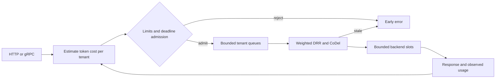

# Vessel

A Go inference gateway that shares limited backend capacity between tenants using adaptive token-cost estimates, weighted deficit round robin (DRR), deadline-aware admission, and CoDel queue management.

## Run in WSL or Linux

Requires Go 1.26+. Protobuf bindings are checked in; protoc is needed only when changing the schema.

```sh
go run ./cmd/vessel
```

The default backend is synthetic and needs no API key or GPU. HTTP listens on `127.0.0.1:8080`; gRPC listens on `127.0.0.1:9090`.

```sh
curl -sS http://localhost:8080/v1/infer \
  -H 'Content-Type: application/json' \
  -d '{"tenant_id":"demo","prompt":"Explain deficit round robin","max_output_tokens":128,"timeout_ms":3000}'

curl -sS http://localhost:8080/metrics
curl -sS http://localhost:8080/healthz
```

`timeout_ms` is optional and defaults to the server's maximum of 10 seconds. HTTP client cancellation and gRPC deadlines propagate to execution. The server caps all requests at `-timeout`.

For gRPC, use the typed client in [api/vessel/v1](api/vessel/v1). With grpcurl installed, the committed schema works without server reflection:

```sh
grpcurl -plaintext -import-path . -proto api/vessel/v1/inference.proto \
  -d '{"tenantId":"demo","prompt":"Hello","maxOutputTokens":128}' \
  localhost:9090 vessel.v1.InferenceService/Infer
```

### Connect a model backend

The upstream adapter sends non-streaming OpenAI-compatible chat completions. Point `-upstream` at the full completions endpoint, not its base URL. The response must include `choices[0].message.content` and `usage.completion_tokens`.

```sh
# Set VESSEL_UPSTREAM_API_KEY in your shell if your backend needs one.
go run ./cmd/vessel \
  -upstream=http://localhost:8000/v1/chat/completions \
  -model=your-model \
  -concurrency=8
```

The upstream URL, model, and API key are server configuration. The adapter supports unary text responses; streaming and tool calls are not supported.

### Scheduling controls

```sh
go run ./cmd/vessel -concurrency=4 -queue=256 -tenant-queue=64 \
  -weights='{"interactive":2,"batch":1}' \
  -codel-target=50ms -codel-interval=100ms

# FIFO concurrency-limiter comparison, retaining the same hard safety limits:
go run ./cmd/vessel -baseline
```

Run `go run ./cmd/vessel -help` for all flags. Weights are positive integers configured by the operator; tenants cannot submit their own weights.

## How requests flow



Defaults: 8 execution slots, 1,024 globally queued requests, 256 queued per tenant, and 128 retained tenant states. Idle tenant predictors are evicted when new tenants need space. Prompt plus maximum output is limited to 65,536 token-units. Request bodies are limited to 1 MiB.

Each tenant starts with a 128-output-token prediction. Successful completions update an EWMA with alpha 0.2. Scheduling cost is estimated prompt tokens plus predicted output capped by the request's maximum. **Prompt tokens currently use a byte-count approximation (`ceil(bytes / 4)`)**; use a model-specific tokenizer before interpreting these units as exact model tokens.

DRR grants 256 token-units times the tenant's weight per round. Credit carries over while backlogged. Completion reconciles prediction error against actual usage. An empty tenant queue resets credit; inactive tenants cannot accumulate an allowance.

Admission estimates queue delay from total queued work and estimated remaining running work divided by the number of slots, adds the new request's service estimate, and applies a 1.25 safety factor. Service time per token starts at 1 ms per slot and adapts from successful execution. The estimate uses aggregate work rather than exact DRR order, so it can reject feasible requests. Backend slowdowns can also invalidate an admission decision.

CoDel tracks each tenant's head-of-queue sojourn time. Delay must remain above 50 ms for 100 ms before shedding starts; further drops use the interval divided by the square root of the drop count. This is a request-queue adaptation of [CoDel](https://www.rfc-editor.org/rfc/rfc8289.html), using a remaining-request guard in place of network packet/MTU accounting. It resets on recovery or an empty tenant queue and omits RFC packet-specific optimizations.

Cancellation removes queued work immediately. Running work receives context cancellation but retains its execution slot until the backend returns. This prevents an uncooperative backend from causing the gateway to exceed the configured concurrency limit. Shutdown cancels queued and running requests and bounds how long the process waits.

## Test and replay

```sh
make check          # go vet, race detector, formatting
make build          # bin/vessel, bin/sim, and bin/bench
make sim            # 160 scenario/seed pairs, both policies, JSONL in results/
make bench          # policy and in-process gateway microbenchmarks
make load           # 2,000 requests/s around an immediate backend for 5 seconds

# Replay a single case:
go run ./cmd/sim -scenario backend_slowdown -seed 7 -seeds 1 -duration 30s

# Longer virtual-time experiment; no wall-clock sleeps:
go run ./cmd/sim -scenario overload -seed 1 -seeds 1 -duration 10000s
```

The eight implemented scenarios are overload, bursts, a noisy neighbor, output-length shift, backend slowdown, backend errors, cancellations, and tight deadlines. Tests run each across seeds 1–20 with fixed accounting, capacity, replay, failure-injection, and non-starvation assertions. Separate policy tests check weighted token fairness and CoDel transitions. Tests run with the race detector in CI; CI also saves the full 30-second simulation matrix as an artifact.

The simulator runs the gateway's scheduling policy with a manual clock and an event heap. Both receive identical arrivals, output lengths, deadlines, service times, failures, and cancellation events. The semaphore baseline uses FIFO plus the same hard queue/tenant limits and honors cancellation/deadlines; it disables DRR, CoDel, and predictive admission.

Report fields:

| Field                        | Population / interpretation                                                                     |
| ---------------------------- | ----------------------------------------------------------------------------------------------- |
| `timely_per_offered`         | Successful completions by deadline / all arrivals, including rejections                         |
| `timely_per_admitted`        | Successful completions by deadline / admitted arrivals, including later sheds and cancellations |
| `completed_p99_ms`           | Arrival-to-response p99 for successful completions only; zero when none complete                |
| `all_terminal_p99_ms`        | Arrival-to-terminal-outcome p99 for all arrivals, including immediate rejections                |
| `wasted_service_seconds`     | Backend slot time consumed by failed, canceled, or expired executions                           |
| `completed_tokens_by_tenant` | Actual prompt plus output work in successful completions                                        |

`make bench` measures the in-process path. `make load` measures the instrumented in-process gateway at 2,000 offered requests/s and reports both gateway-call overhead and scheduled-arrival latency; it excludes network serialization and model generation. See [docs/benchmark.md](docs/benchmark.md) for recorded local results and methodology.

## Metrics and containers

`/metrics` uses the official [Prometheus Go client](https://github.com/prometheus/client_golang). For requests reaching the gateway, it exports terminal counts by outcome, all-outcome request latency, dispatched-request queue wait, current queue depth, occupied slots, and Go/process metrics. No tenant IDs or prompts appear as metric labels.

```sh
docker compose up --build
```

The container runs as a non-root user. Compose binds the gateway to localhost ports 8080/9090 and Prometheus to localhost port 9091. Metrics scrape internally at `vessel:8080`.

On WSL, enable this distro under **Docker Desktop → Settings → Resources → WSL Integration** before using Compose. The Go commands above run directly in WSL without Docker. For a model server running on Windows rather than WSL, use the Windows host address appropriate to your WSL network mode; a container's `localhost` points to that container.

Tenant IDs are caller-supplied and listeners use plaintext. Use the loopback defaults for local development. A shared deployment needs an authenticated ingress that supplies trusted tenant identity, TLS termination, and protected metrics. Limits apply to one process; multiple replicas do not coordinate tenant fairness. Upstream compute cost is approximated as prompt-plus-output tokens, not GPU batching time or money.

## Layout

- `internal/policy`: clock-independent prediction, admission, DRR, and CoDel.
- `internal/gateway`: concurrency, cancellation, execution lifecycle, and metrics.
- `internal/backend`: synthetic and OpenAI-compatible HTTP backends.
- `internal/transport`: HTTP and gRPC handlers.
- `internal/sim`: seeded workloads, virtual clock, and discrete-event runner.
- `api/vessel/v1`: protobuf schema and Go client/server bindings.
- `cmd/vessel`, `cmd/sim`, `cmd/bench`: server, replay, and load measurement commands.

After editing the gRPC schema, run `make proto` with protoc v33.0. The script uses pinned Go plugins and updates the checked-in bindings.
